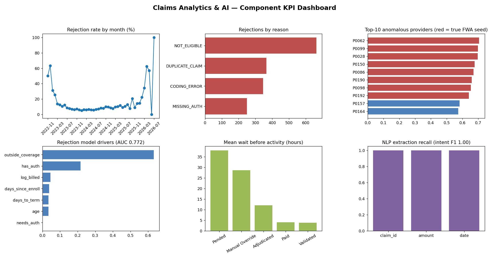

# claims-ai-analytics
AI-powered claims analytics project

# Claims Analytics & AI Pipeline

End-to-end analytics project on **synthetic healthcare claims data**: data quality → SQL analysis → anomaly detection & risk scoring → NLP on call transcripts → process mining → KPI dashboard.

> All data is synthetic and generated by `src/generate_data.py` (seeded, reproducible). It is deliberately messy (nulls, duplicates, negative amounts, invalid dates, orphan keys) so the cleaning and data-quality layers have real work to do. No real patient data is used.



## What it does

| Stage | Module | What it covers |
|---|---|---|
| Data quality | `src/data_quality.py` | Reusable checks (nulls, negatives, duplicates, invalid dates, orphan keys) returning a pass-rate report; column profiling; cleaning functions |
| SQL | `sql/queries.sql`, `src/sql_analysis.py` | SQLite database; CTEs, window functions, joins: rejection reasons, provider billing vs specialty peers, monthly trend, claims outside coverage |
| Anomaly detection | `src/models.py` | Isolation Forest on provider-level features (billed-amount ratio vs procedure median, rejection rate, claims per member) to surface FWA-style patterns |
| Rejection-risk scoring | `src/models.py` | Gradient boosting classifier, feature importance, Low/Medium/High risk stratification |
| NLP | `src/nlp_transcripts.py` | Regex entity extraction (claim ID, amount, date) from call transcripts plus TF-IDF intent classifier, evaluated against human-reviewed labels |
| Process mining | `src/process_mining.py` | Variants, directly-follows graph, rework rate, manual-override rate, bottlenecks (pure pandas) |
| KPIs / BI | `src/dashboard.py` | Exports tidy CSVs to `outputs/bi_exports/` for Power BI / Tableau and renders a static KPI dashboard |

## Run it

```bash
pip install -r requirements.txt
python run_pipeline.py      # generates data, runs everything, writes outputs/
pytest                      # unit tests
```

## Results (seed 42)

- **Data quality:** 20,120 raw claims → 19,627 clean; every injected defect type is detected (see `outputs/data_quality_report.csv`).
- **Anomaly detection:** 8 providers were seeded with inflated billing. The top-10 anomaly scores contain all 8 (recall@10 = 1.0, precision@10 = 0.8).
- **Rejection model:** ROC-AUC 0.77, PR-AUC 0.49 (base rate 8.3%). Precision 0.69, recall 0.48 at a 0.5 threshold. Missing coverage and missing authorization are the main drivers.
- **Process mining:** 22.7% of claims go through rework (pended and re-validated); 7.5% need a manual override; "Pended" is the largest bottleneck (~43h mean wait).
- **NLP:** extraction and intent classification both score ~100% on the synthetic transcripts.

## Limitations (please read)

- The data is synthetic, so metrics show the pipeline works, **not** how it would perform on real claims. Real data will be noisier.
- Transcripts are template-generated, so the ~100% NLP scores are an upper bound. Real call transcripts would need more robust extraction (e.g. spaCy NER or an LLM) and a harder evaluation.
- Anomaly detection is evaluated against the seeded providers, which is only possible because the data is synthetic.
- The dashboard is a static matplotlib render. The CSVs in `outputs/bi_exports/` are structured to load directly into Power BI or Tableau.

## Building the Power BI / Tableau dashboard

Load `outputs/bi_exports/*.csv`. Suggested pages: (1) Claims overview: `monthly_trend`, `rejection_by_reason`; (2) FWA: `anomalies`, `provider_billing_vs_peers`; (3) Model performance: `risk_tiers`, `feature_importance`; (4) Process: `process_variants`, `bottlenecks`; (5) Data quality: `dq_report`, `nlp_extraction_eval`.

## Project structure

```
src/        data generation, data quality, SQL, models, NLP, process mining, dashboard
sql/        analytical queries
tests/      unit tests
docs/       dashboard image
run_pipeline.py
```
